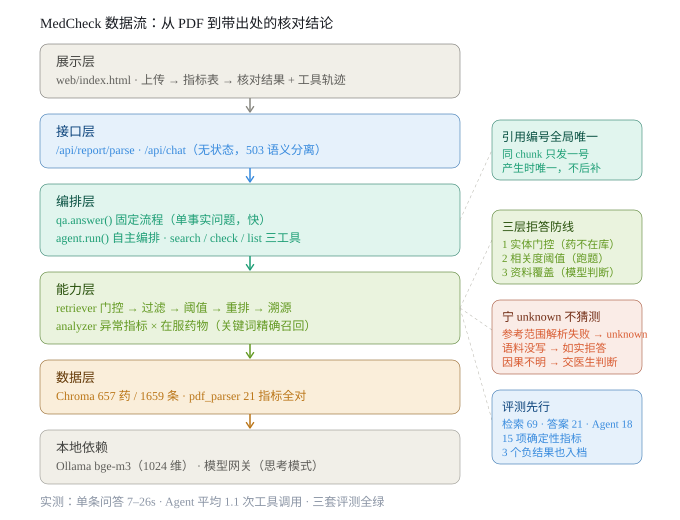

# MedCheck

体检报告解读与用药禁忌核查 Agent —— 一个可运行、可演示、可现场修改的医疗 RAG + Agent 工程样本。

**当前进度：Week 3 / 10 · 知识库已可检索**（详细排期见 [路线图](#路线图)）

> ⚠️ **免责声明**
> 本项目为技术学习与技术演示用途，全部输出**不构成任何医疗建议、诊断或用药依据**。
> 请勿将本系统的任何结果用于真实的健康决策。如有健康问题，请咨询执业医师。
> 本项目仅使用公开发布的药学资料与合成数据，**不接入、不存储任何真实患者数据**。

---

## 这是什么

一份体检报告交到普通人手里，最难的往往不是看懂数值，而是不知道哪些异常该立刻就医、哪些只是需要复查，以及正在吃的药和异常指标之间有没有冲突。

MedCheck 想解决的问题只有两个：

1. **把报告读懂**：从 PDF 里结构化抽取检验指标，按「请就诊 / 待复查 / 日常管理」分级，**每条结论都标注原文来源与页码**
2. **把风险查出来**：输入正在服用的药物，检索药品说明书中的禁忌与相互作用，给出带引用的风险提示

技术上，这是一个完整的 RAG + Agent 工程实践：文档解析 → 结构化切分 → 向量检索 + 关键词检索 → 重排序 → 引用溯源 → 工具调用 → 评测闭环 → 容器化部署。



> 现场演示流程见 [docs/demo.md](docs/demo.md)（5 分钟脚本 + 高频追问应答）。
> 换一台电脑部署见 [SETUP.md](SETUP.md)（两种方式 + 常见问题速查）。

## 现在能做什么

| 能力                     | 状态        |
| ---------------------- | --------- |
| 服务启动与健康检查（`/health`）   | ✅ 已完成     |
| 配置从环境变量注入              | ✅ 已完成     |
| 结构化日志                  | ✅ 已完成     |
| 单元测试（接口 + 配置）          | ✅ 已完成     |
| **PDF 报告解析与指标结构化**     | ✅ 已完成（见 [能力边界](#能力边界)） |
| 知识库构建（切分 / 向量化 / 入库）   | ✅ 657 药 / 1659 条 / 1024 维 |
| 混合检索 + 重排序 + 引用溯源      | ✅ 重排与溯源完成；混合检索经评测否决 |
| 报告解读生成（带强制引用）          | ✅ 本地 7b 跑通，引用标注 4/4 |
| **报告核对（异常指标 × 在服药物）** | ✅ 见 [报告核对](#报告核对把异常指标和在服药物连起来) |
| **用药禁忌核查 Agent（工具调用）** | ✅ 3 个工具，模型自主编排 |
| 评测集与批量评测 Harness     | ✅ 检索 69 + 答案 21 + Agent 18 条，共 15 项指标 |
| Docker 化部署             | ✅ 已完成（镜像 1.01GB） |
| **演示界面（上传→指标→核对）**  | ✅ 单页应用，容器内同样可用 |

**说明**：本仓库按周迭代，README 如实反映当前进度，不提前描述未完成的能力。

## 快速开始

环境要求：Python 3.11+、[uv](https://docs.astral.sh/uv/)

```bash
# 1. 安装依赖
uv sync

# 2. 启动服务
uv run uvicorn app.main:app --reload

# 3. 验证服务
curl http://127.0.0.1:8000/health
```

预期返回：

```json
{"status": "ok", "env": "dev", "version": "0.1.0"}
```

交互式接口文档：<http://127.0.0.1:8000/docs>

### 解析一份示例报告

```bash
uv run python -m scripts.parse_report data/samples/report_demo.pdf
```

### 核对你自己的报告和用药

先准备知识库（只需一次），再带上在吃的药：

```bash
uv run python -m scripts.build_index data/corpus/drugs_all.jsonl     # 建库，约 17 分钟
uv run python -m scripts.report_check data/samples/report_demo.pdf --meds 阿托伐他汀,布洛芬
```

不带 `--meds` 时只列异常清单，不调模型、不需要 Ollama。

> ⚠️ 注意用 `-m`（模块方式）而不是直接给文件路径。直接跑 `python scripts/parse_report.py`
> 会因为 `sys.path` 只包含 `scripts/` 而报 `ModuleNotFoundError: No module named 'app'`。

输出节选（共 21 条指标，此处只展示 3 条）：

```json
{
  "report_id": "20261022A0031",
  "exam_date": "2026-10-22",
  "items": [
    {
      "name_raw": "丙氨酸氨基转移酶 ALT",
      "name": null,
      "value": 68.0,
      "unit": "U/L",
      "ref_low": 9.0,
      "ref_high": 50.0,
      "flag": "high",
      "page": 1
    },
    {
      "name_raw": "血红蛋白 HGB",
      "value": 108.0,
      "unit": "g/L",
      "ref_low": 130.0,
      "ref_high": 175.0,
      "flag": "low",
      "page": 1
    },
    {
      "name_raw": "C 反应蛋白 CRP",
      "value": 11.2,
      "unit": "mg/L",
      "ref_low": null,
      "ref_high": 8.0,
      "flag": "high",
      "page": 1
    }
  ]
}
```

> 最后一条演示了单边参考范围 `<8` 的处理：下限为 `null`，上限为 `8.0`。

### 验证数据

| 项目          | 结果                          |
| ----------- | --------------------------- |
| 样本指标总数      | 21 条                        |
| 正确解析        | **21 / 21**                 |
| 异常指标判定      | **11 条，与人工核对 100% 一致**      |
| 其中使用字母标记的    | 7 条（4 条 `H` + 3 条 `L`，非箭头，未依赖报告标记） |
| 单边参考范围的     | 1 条（`<8`）                   |

## 能力边界

明确说明「不做什么」比声称全能更可信。以下为实测结论：

| 场景                | 支持情况                     | 说明                                  |
| ----------------- | ------------------------ | ----------------------------------- |
| 单栏版式检验报告          | ✅ 21 / 21 正确            | 当前按固定模板的列索引解析                       |
| 多栏 / 异构版式         | ⚠️ 产出 `unknown`，不静默出错    | 实测双栏样本产生 63 条（含噪声行）、33 条 `unknown` |
| 扫描件（图片型 PDF）      | ❌ 不支持                    | 需 OCR，不在当前范围                        |
| 定性结果（阴性 / 阳性 / `+`） | ❌ 跳过该行                   | 后续版本处理                              |

**设计原则**：解析不确定时标记为 `unknown`，绝不猜测一个参考范围。宁可少一条结论，也不要给错误结论。

## 容器化部署

```bash
cd docker
docker compose up --build
curl http://127.0.0.1:8000/health
```

```
{"status":"ok","env":"docker","version":"0.1.0-dev"}
```

镜像 `medcheck-api:dev`，体积 **1.01GB**，容器自带 healthcheck，`docker compose ps` 会显示 `(healthy)`。

### 三个刻意的设计

| 设计 | 原因 |
| --- | --- |
| `--host 0.0.0.0` | uvicorn 默认只监听 `127.0.0.1`，那是容器内部的回环地址，宿主机通过端口映射访问不到，表现为「容器起来了但浏览器打不开」 |
| `uv sync --no-cache` | 不加的话 uv 会把包再解压一份到 `/root/.cache/uv`，实测多出 **543MB**，与 `.venv` 完全重复 |
| healthcheck 用 `python -c urllib` 而不是 `curl` | slim 镜像里没有 curl，为检查健康状态去装一个会白占体积 |

### 容器访问宿主机服务

容器内的 `localhost` 指容器自己。宿主机上的服务必须走 `host.docker.internal`：

```yaml
environment:
  # 两个都要配，少一个 Agent 就只在固定流程下工作
  EMBEDDING_BASE_URL: http://host.docker.internal:11434/v1   # Ollama 向量化
  LLM_BASE_URL: http://host.docker.internal:7863/v1          # 对话模型网关
  FASTEMBED_CACHE_PATH: /app/data/models                     # 重排模型缓存
extra_hosts:
  - "host.docker.internal:host-gateway"
```

三个实测结论：

| 项 | 结果 |
| --- | --- |
| `host.docker.internal` 解析 | → `192.168.65.254` |
| 容器内探测模型网关 | 返回 **401** 而不是超时 —— 说明网络通，只是探测请求没带 key |
| 容器内完整问答 | 首次 **101s**，第二次 **10.9s** |

首次慢是重排模型（570MB）加载。所以 `FASTEMBED_CACHE_PATH` 必须指向挂载目录——默认它在 `/tmp`，容器一重启就没了，下次请求要重新下载 570MB。指到 `/app/data/models` 后实测落盘 **561MB**，重启复用。

> 一个容易踩的坑：`LLM_BASE_URL` 不配的话，解析接口照常工作（不依赖模型），
> 但一旦问需要生成的问题就会 503。**部署后一定要跑一次 `/api/chat` 验证**，
> 只测 `/health` 发现不了这个问题。

### 镜像体积构成

| 包 | 体积 | 说明 |
| --- | --- | --- |
| pymupdf | 110MB | PDF 解析，必需 |
| kubernetes | 75MB | **chromadb 的传递依赖**，本地单机模式完全用不到 |
| onnxruntime | 63MB | chromadb 自带 embedding 的依赖，我们用外部 embedding，用不到 |
| numpy + numpy.libs | 59MB | 数值计算，必需 |

后续可优化：换用更轻的向量库，或拆分「只跑 API 的精简镜像」。当前阶段优先保证功能完整。

## 知识库与检索

### 建库

```bash
# 需要先启动 Ollama（模型 bge-m3）
uv run python -m scripts.build_index
```

```
读取语料：data/corpus/drugs.jsonl
共 85 条
向量化完成，耗时 28.5s，维度 1024

建库完成：data/chroma
  集合条目数：85
  药品数量：28
  章节类型：注意事项、禁忌、药物相互作用
```

收录 28 种常用药（二甲双胍、利伐沙班、华法林、卡托普利、呋塞米、地高辛、多潘立酮、头孢克肟、奥美拉唑、对乙酰氨基酚、左氧氟沙星、左甲状腺素钠、布洛芬、氨氯地平、氯吡格雷、氯沙坦、氯雷他定、瑞舒伐他汀、甲硝唑、硝酸甘油、美托洛尔、蒙脱石散、螺内酯、阿卡波糖、阿司匹林、阿奇霉素、阿托伐他汀、阿莫西林），每药各含「禁忌 / 注意事项 / 药物相互作用」三章。

### 药品覆盖范围：663 个可识别 vs 657 个可回答

用户可能问任何一种药。**如果系统「不认识」这个药名，它不会拒答，而会拿语义上最接近的别的药去凑答案**——这是本项目最危险的一类错误。

因此引入官方药品名称索引：**国家基本药物目录（2018 年版）**，国家卫健委公开文件，共 **663 个通用名**（化学药品 396 + 中成药 267）。

| 概念 | 含义 | 数量 |
| --- | --- | --- |
| **可识别** | 系统认识这个药名（索引内） | 663 |
| **可回答** | 语料里有说明书内容 | 657 |
| **缺口** | 认识但没资料，必须拒答 | **9** |

9 个缺口是：口服补液盐、归脾丸、格列本脲、毛果芸香碱、氯胺酮、甲钴胺、艾司唑仑、阿昔洛韦、黄连羊肝丸。它们不是遗漏，而是抓取时搜不到详情页或页面缺章节——**正好构成了拒答能力的测试样本**。

#### 一个必须处理的匹配陷阱：子串

「阿莫西林」是「阿莫西林克拉维酸钾」的子串。若不处理，问**复方制剂**会命中单方成分，然后用单方的资料作答——**答案看起来完全合理，但说的不是同一个药**。这比拒答危险。

处理方式是命中后去掉「被更长药名包含」的短名：

```
阿莫西林克拉维酸钾的禁忌  →  unsupported=['阿莫西林克拉维酸钾']   ← 正确
                          不是  matched=['阿莫西林']              ← 错误
```

同类陷阱在本目录里还有几组：青霉素 / 苄星青霉素、头孢曲松 / 头孢他啶、胰岛素各剂型。

### 语料扩充：28 种 → 657 种药

两个数据源，两步走：

| 用途 | 来源 | 规模 |
| --- | --- | --- |
| 药品名称索引 | 国家基本药物目录（2018 年版），国家卫健委公开文件 | **663 个通用名** |
| 说明书章节 | 中国医药信息查询平台（国家药监局主管） | **657 种药 / 1659 条** |

```bash
uv run python -m scripts.build_drug_index   # 由目录 PDF 生成药名索引（表名）
uv run python -m scripts.scrape_labels      # 抓取说明书章节（串行 + 0.4s 延迟，可续跑）
uv run python -m scripts.merge_corpus       # 合并：人工核对版优先，抓取版补充
uv run python -m scripts.build_index data/corpus/drugs_all.jsonl
```

合并策略：原有 28 种药的 85 条是逐条核对过的，**同药同章节时优先保留人工版本**，抓取内容只补缺。替换会动到评测基线的既有变量，没必要。

### 规模化之后：检索准确率一点没掉

这是本次扩充最重要的发现。

| 语料规模 | 药品数 | 检索总体正确（无重排） | 延迟中位 |
| --- | --- | --- | --- |
| 85 条 | 28 | 88.9% | 274 ms |
| **1659 条** | **657** | **88.9%** | 356 ms |
| 1659 条（+重排） | 657 | 92.6% | 约 800 ms |

**语料扩大 20 倍，准确率完全不变，失败的还是同样那 3 条（章节错配）。**

原因是：实体门控先把检索范围限定到单一药品（`where={"drug": ...}`），再在 3 个章节里比相似度。**干扰项虽多，但根本进不了候选集。**

**结论：扩语料提升的是「覆盖面」，不是「检索质量」。** 想提高检索质量得解决意图识别，不是加数据量。这也解释了为什么之前加 BM25、切分、重排都收效甚微——瓶颈从来不在数据量。

### 评测集必须随语料重校准（踩了 4 次）

扩充语料后，原来标为「应拒答」的药（别嘌醇、辛伐他汀、青霉素等）现在有资料了。**如果不同步改标注，系统行为正确也会被判为错误。**

本次修正 | 数量
--- | ---
`goldset_hard` 替换 3 条拒答用例 | 辛伐他汀/缬沙坦/格列美脲 → 格列本脲/甲钴胺/艾司唑仑
`answerset` 改判 4 条 | 别嘌醇/辛伐他汀/青霉素 → 应作答；奥司他韦「怎么吃」→ 应拒答（语料无用法用量）

累计四次标注错误（甲硝唑喝酒、瑞舒伐他汀血糖、头孢克肟双硫仑、奥司他韦用法），**全部是「我以为语料里有，实际没有」或「我以为该答，实际资料不够」**。这不是系统的问题，是标注必须逐条对着语料核。

代价与限制：建库 17 分钟（1659 条 × 600 字），抓取 20 分钟；抓取正文截断在 600 字，长章节不完整；651/663 抓到，9 种仍无资料（口服补液盐、归脾丸、格列本脲、毛果芸香碱、氯胺酮、甲钴胺、艾司唑仑、阿昔洛韦、黄连羊肝丸）——这 9 种正是拒答能力的测试对象。

### 检索

```bash
uv run python -m scripts.search "华法林的禁忌是什么" --top 3
uv run python -m scripts.search "药物相互作用" --drug 华法林    # 限定药品范围
```

实测效果（top-1 全部命中正确药品与章节）：

| 查询 | top-1 结果 | 相似度 |
| --- | --- | --- |
| 华法林的禁忌是什么 | 华法林 · 禁忌 | 0.692 |
| 阿托伐他汀对肝功能有什么影响 | 阿托伐他汀 · 注意事项 | 0.684 |
| 布洛芬和阿司匹林能一起吃吗 | 布洛芬 · 药物相互作用 | 0.691 |

### 语料的组织方式

语料按**说明书章节**切分，不按字数切：

| 做法 | 结果 |
| --- | --- |
| 按 500 字硬切 | 可能把一句禁忌劈成两半，检索出半句话 |
| **按【禁忌】【注意事项】【药物相互作用】切** | 一个章节即一个完整语义单元 |

向量化时把药名和章节名一起拼进去（`f"{drug}【{section}】{text}"`），否则正文里只有「本品」二字，查「华法林的禁忌」匹配不上。

### 拒答机制：三层防线

向量检索**永远会返回 top-k 条结果，即使语料里根本没有相关内容**。实测语料中没有「别嘌醇」，查询 `别嘌醇的禁忌是什么` 仍然返回布洛芬·禁忌，相似度 **0.612** —— 这个分数看起来完全正常，肉眼分辨不出是错的。

实测分布说明了为什么不能用「相似度阈值」当唯一防线：

| 分组 | 相似度区间 |
| --- | --- |
| 相关（库内有该药） | **0.654** – 0.831 |
| 不相关（药不在库内） | 0.472 – **0.667** |
| 完全无关（天气 / 编程 / 做饭） | 0.329 – 0.375 |

**两组直接重叠**：库里有的「美托洛尔」只有 0.654、「卡托普利」只有 0.659，而库里没有的「阿司匹林」（当时未收录）却有 0.667。**没有任何阈值能同时做到「不误拒美托洛尔」和「不误答阿司匹林」。**

所以实现了三层防线：

| 层 | 做法 | 拦截什么 |
| --- | --- | --- |
| **① 实体门控** | 从问题里识别药名，不在库内直接拒答，不走向量检索 | 「问别嘌醇返回布洛芬」这类**最危险**的错误 |
| **② 元数据过滤** | 命中药品后，用 `where={"drug": ...}` 限定检索范围 | 跨药品串味 |
| **③ 相关度阈值** | top-1 相似度 < 0.45 拒答 | 完全跑题的问题 |

阈值 0.45 来自上面的实测数据（完全无关 ≤ 0.375），**但换 embedding 模型后必须重新测量，这个值不能跨模型复用**。

**「库内有哪些药」不写在代码里，而是从向量库元数据实时读取。** 早期版本把支持的药名硬编码成一份清单，语料从 8 个药扩到 28 个之后，阿司匹林等 9 个药明明已经入库，却仍被列为「未收录」而遭拒答 —— 详见 [踩坑记录](#踩坑记录)。

回归验证（38 条用例：28 条库内药 + 7 条库外药 + 3 条完全跑题）：

```
28 条库内药   全部放行，且命中正确药品
 7 条库外药   全部拒答，理由均为「未收录」
 3 条跑题     全部拒答，理由均为「相关度过低」
失败 0 项
```


### 引用溯源

医疗场景里最不可接受的是「答得斩钉截铁却查不到出处」。所以出处不是展示层的美化，而是**数据层的硬要求**：检索结果必须带着出处，一路传到最终答案。

```python
@dataclass(frozen=True)
class Citation:
    source: str            # 出处文档名，如「华法林钠片说明书」
    section: str | None    # 章节，如「禁忌」
    chunk_id: str | None   # 片段 id，供调试定位
    page: int | None       # 页码，仅体检报告类来源有
```

**两类出处必须分开表达**，因为它们的信息维度不同：

| 来源 | 定位方式 | 原因 |
| --- | --- | --- |
| 药品说明书 | 文件 + **章节** | 语料按说明书章节切分，本身没有页码概念 |
| 体检报告 | 文件 + **页码** | 页码来自 PDF 解析阶段记录的 `page` 字段 |

所以 `Citation` 用 `section` 和 `page` 两个字段分别承载，而不是硬塞进一个 `location` 字符串。

命令行输出（先结论、再出处、后原文）：

```
查询："华法林的禁忌是什么"
✅ 可以回答 —— 命中「华法林」的说明书章节

出处：
  [1] 华法林钠片说明书 · 禁忌
  [2] 华法林钠片说明书 · 注意事项

1. [相似度 0.692] 华法林 · 禁忌
   华法林【禁忌】下列情况禁用华法林：肝肾功能损害…
   来源：华法林钠片说明书（drug-001-禁忌）
```

**一条铁律：拒答时绝不给出处。** 原因不是省事——列出出处会让用户误以为「系统查过资料但不想说」，而事实是根本没有可用资料。这条有专门的单元测试守着（`test_refusal_has_no_citations`）。

**去重规则**：同一文件同一章节的多个片段合并为一条出处。用户不需要知道这是该章节的第 1 段还是第 3 段，`chunk_id` 保留在对象里供开发和调试使用。

### 生成层：让模型读资料回答

检索层的两处缺口（「排序错但答案在 top-3 里」「语料没覆盖却放行」）在生成层得到解决。核心是一条朴素的原则：**把候选资料全部交给模型，让它自己判断够不够**。

三道拒绝关卡：

| 层 | 判据 | 位置 |
| --- | --- | --- |
| ① 实体门控 | 问题里的药不在库里 | `retriever` |
| ② 相关度阈值 | 检索结果向量相似度 < 0.45 | `retriever` |
| ③ **资料覆盖判断** | 资料里没有答案 | `llm.qa`（模型判断） |

第三道是关键补充。以「华法林是饭前吃还是饭后吃」为例：语料里没有任何服药时间的内容，但向量相似度 0.5715 高于阈值会被放行。加入生成层后：

```
问题：华法林是饭前吃还是饭后吃
⛔ 拒答 —— 资料中未提及问题所涉及的内容
   回答：资料中未提及
```

**拒答用固定短语做契约**（`REFUSAL_PHRASE = "资料中未提及"`）。提示词要求模型在找不到依据时只输出这一句，检测就变成确定性的字符串包含判断，不需要再调一次模型去判别。这对小模型尤其重要——它们的输出格式不稳定。

### 生成层纠正了检索层的排序错误

W4 遗留的两条错例之一「阿司匹林会不会把胃吃坏」，检索层始终把「药物相互作用」排在「注意事项」前面（差距 0.0037）。接入生成层后：

```
会。……长期大量用药可抑制凝血酶原合成、诱发消化道溃疡出血，手术前应停药 [2]。
```

**正确依据其实一直在 top-3 里，只是没排第一。** 模型读得懂全文，可以自己做一次语义级重选——这解释了为什么在 embedding 能力不足时，加大检索工程投入不如先补生成层。

### 一个可监控的质量信号：模型是否真的标了引用

模型偶尔会忘记标注 `[1]`。这时 `Answer.cited` 为 `False`，出处退化为「候选资料全量列出」，并在命令行显式提示：

```
⚠️ 答案中未出现引用标记，出处为候选资料全量列出
```

**没有掩盖，而是把它变成可观测指标。** 引用标注率可以直接作为 W7 评测的一项。

### 模型选择：1.5b 还是 7b

同一套提示词、同一批 6 个问题，两个本地模型各跑一遍（`uv run python -m scripts.compare_llm`）：

| 模型 | 行为正确 | 引用标注 | 延迟中位 | 答案长度 |
| --- | --- | --- | --- | --- |
| qwen2.5:1.5b | 6/6 | **1/4** | 4.3s | 73 字 |
| qwen2.5:7b | 6/6 | **4/4** | 18.7s | 96 字 |

**两者的「会不会拒答」判断完全一样（都是 6/6），差别全在引用标注上。**

问「阿司匹林会不会把胃吃坏」，7b 的回答：

```
阿司匹林可能增加胃肠道出血的风险[1]，长期大量用药可诱发消化道溃疡出血[2]。
因此，阿司匹林有可能把胃"吃坏"。[1][2]
```

1.5b 的回答同样答"会"，但混进了「可增强磺脲类降糖作用」「丙磺舒、磺吡酮的排尿酸作用受本品拮抗」——那是「药物相互作用」章节里与问题无关的内容。

**结论：默认模型定为 7b。** 生成层最怕的不是啰嗦，而是「说得像样但标不出出处」。4.3s 对 18.7s 的差距可以接受——接云端 API 后会降到 2–3 秒。

> 这次对比也说明了为什么必须有客观指标：只看 1.5b 的首条回答你会觉得「能用」，跑完 6 条才发现它的引用标注率只有 25%。

### 接入云端推理模型：思考过程怎么处理

本地 7b 有两个硬伤：一次调用 45 秒，且判断语义关系时不可靠（见 [报告核对](#报告核对把异常指标和在服药物连起来)的已知局限）。换成云端模型是顺势而为。

**但推理模型和普通模型不是一回事**，它的响应里有两个字段：

```
message.reasoning_content   思维链（模型在「想」什么）
message.content             最终答案
```

本项目把两者严格分开：**评测和判定只看 `content`，`reasoning_content` 只用于观察和调试。**
理由很实际——引用标记 `[1]`、拒答短语都在 `content` 里；如果把思考内容和答案拼成一个字符串，思考过程里出现的方括号会被误判成引用编号。

#### 模型名已经改过一轮，别照着旧教程抄

DeepSeek 当前的模型名是 `deepseek-flash` / `deepseek-v4-pro`，思考模式用显式参数开启：

```json
{"model": "deepseek-flash", "thinking": {"type": "enabled"}, "reasoning_effort": "high"}
```

旧的 `deepseek-chat` / `deepseek-reasoner` 已在 2026-07-24 下线。另外在 OpenAI SDK 里 `thinking` 必须塞进 `extra_body`，否则会被 SDK 吞掉——本项目直接用 httpx 发原始 JSON，不存在这个问题。

端点也有个细节：DeepSeek 官方给的 base_url 是 `https://api.deepseek.com`，**不带 `/v1`**。

#### 三个必须知道的规则

| 规则 | 说明 |
| --- | --- |
| **不带 `tools` 时不必回传 `reasoning_content`** | 传了也会被服务端忽略，不拼进上下文 |
| **带 `tools` 时必须完整回传** | 否则 API 直接返回 400。本项目当前全是单轮调用，用不到；W6 做工具调用时必须用 `ChatReply.as_assistant_message()` |
| **思考模式不支持 `temperature`** | 设了不报错，但也不生效。所以客户端在思考模式下**主动不发送这个参数**——发一个静默无效的值只会让日志看起来像是生效了 |

最后一条值得单独说。`temperature` 被静默忽略是最难排查的一类问题：调用成功、没有报错、日志正常，但实际行为和你的预期不一致。**参数有没有生效，不能靠「没报错」判断。**

#### 实现上的三个取舍

**① `chat()` 返回字符串，`complete()` 返回完整对象**

现有问答和报告解读都只需要答案内容，让它们继续调 `chat()` 就不用改一行代码。需要看思考过程的场景（探测脚本、W6 的 Agent 循环）用 `complete()`。

**② 思考模式下不传 `temperature`**

不是「传了无所谓」，而是刻意省略。代码里 `thinking_active` 这个属性就是判断依据。

**③ 空答案直接报错，且不重试**

思考模式下如果 `max_tokens` 太小，会出现「思考完了但没输出答案」。这种情况如果静默返回空字符串，上层会把它当成「拒答」——**于是配置错误被伪装成「资料不足」，排查方向就全歪了**。

同时这类错误不进重试循环：解析类问题重试没有意义，同一份请求再发一次结果一样。

#### 怎么切过去

```bash
# 1. 填 .env
LLM_BASE_URL=https://api.deepseek.com
LLM_MODEL=deepseek-flash
LLM_API_KEY=sk-你的key
LLM_REASONING_EFFORT=high     # 可省，默认就是 high

# 2. 先探活，别一上来就跑完整流程
uv run python -m scripts.probe_llm --show-reasoning

# 3. 探活通过后再跑评测，看指标有没有变化
uv run python -m scripts.run_answer_eval
```

`probe_llm` 会打印端点、模型、思考字数、思考 token 占输出的比例，以及完整思考过程。**换后端的第一步永远是先探活**——报错信息在这里最干净，混在检索日志里很难认。

#### 实测：换后端确实零代码改动

实际接入的不是 DeepSeek 官方，而是一个本地网关（`http://localhost:7863/v1`，模型 `cn:hy3`）。**只改了 `.env` 三行，`app/` 下一行代码没动**——这正是当初坚持走 OpenAI 兼容协议的理由。

| 项 | 本地 qwen2.5:7b | 网关 cn:hy3 |
| --- | --- | --- |
| 单次问答延迟 | 18.7s | **3.8s** |
| 报告核对 5 项 | 2 项判错，其中 1 项编造原文 | **5 项全对** |
| 引用标注 | 4/4 | 5/5 |
| 思考过程 | 无 | 有，247 字 |

思考 token 占输出 **85%**（134 / 157）。这意味着**推理模型的成本大头不在答案，在想答案的过程**——短问题上这个比例只会更高。

> 探测脚本第一次跑时显示「思考模式：未开启」，却打印出 247 字思考内容。原因是我把「有没有发送 `thinking` 参数」和「服务端有没有返回思考」混成了同一个指标。**有的网关默认就返回思维链，即使不传任何参数。** 这两件事必须分开报告：前者是配置状态，后者是实际行为。

#### 换模型带来的第一个问题：过度拒答

换完模型首次跑答案评测只有 **19/21**，两条都是「资料里明明有答案却拒答」。

以「华法林和什么药不能一起吃」为例，检索第一条就是：

```
华法林【药物相互作用】阿司匹林、水杨酸钠、吲哚美辛……可增强抗凝作用
```

模型却输出「资料中未提及」。它认为原文没有出现「不能一起吃」这几个字，所以不算回答。

**这是推理模型更常见的失效方向：它更严格地判断「资料是否直接给出了问题里的结论」，而不是「资料里有没有相关信息」。** 小模型恰恰相反——更容易硬答。

改法是把判断标准写清楚，并且把边界一起写明：

```
判断资料够不够用，看的是「能否据此回答问题」，不是「原文有没有写出问题里的结论」。
  问「什么药不能一起吃」，资料写「某药可增强本品抗凝作用」→ 能回答
  问「会不会伤肝」，资料写「用药期间应复查肝功能、转氨酶升高需减量」→ 能回答

但上一条不等于可以勉强作答。如果资料讲的是另一件事
（问服药时间而资料只讲监测指标、问忌口而资料只讲不良反应），仍然要拒答。
```

改完 **21/21**。关键是同时抽查了三条该拒的问题（服药时间、牛奶同服、减肥），**仍然全部拒答**——放宽标准没有导致误答。

> 这一步必须两边都测。只验证「该答的能答」，会漏掉「该拒的变成硬答」——而后者在医疗场景更危险。

#### 副作用：可复现性下降

之前本地 7b 温度固定 0，同样的输入必得同样的输出，评测跑一次就能定论。推理模型下**这个保证失效了**——思考模式不支持 `temperature`，采样仍有随机性。

实证：同一问题「多潘立酮会导致心脏问题吗」在完整评测里被记为「拒答」，但单独连跑三次**全部正确作答**。差一点就把一次偶发当成模型缺陷写进报告。

**待做**：评测脚本加 `--repeat N`，同一用例跑多次取稳定值。单次运行的偶然结果不该直接写进结论。

### 答案级评测

检索评测只能说明「找到了正确的资料」，说明不了「答案对不对」。所以另建一套 `eval/answerset.jsonl`（21 条：应作答 10 / 语料未覆盖 4 / 索引内但无资料 7），跑完整问答链路。

```bash
uv run python -m scripts.run_answer_eval
uv run python -m scripts.run_answer_eval --model qwen2.5:1.5b   # 换模型对比
```

**五项指标全部是确定性判定**，不引入「用模型评模型」这个不可靠环节：

| 指标 | 判据 |
| --- | --- |
| 行为正确 | 该答的答了、该拒的拒了 |
| 引用标注率 | 答案里是否出现 `[n]` 标记（正则） |
| 引用有效率 | 引用的编号是否落在实际资料条数范围内 |
| 关键点命中率 | 答案是否包含预先标注的关键词（子串匹配） |
| 药名幻觉 | 答案提到的药名是否根本不在本次资料里（词表扫描） |

#### 两个模型的答案级对比

| 指标 | qwen2.5:7b | qwen2.5:1.5b |
| --- | --- | --- |
| 行为正确 | **21/21 = 100%** | — |
| 引用标注率 | **10/10 = 100%** | 4/11 = 36.4%（16 条版） |
| 引用有效率 | **10/10 = 100%** | 4/11 = 36.4% |
| 关键点命中率 | **10/10 = 100%** | 9/10 = 90% |
| 药名幻觉 | 0 条 | 0 条 |
| 延迟中位 | 5.8s | — |

**新增的 5 条「索引内有、语料里没有」的药全部正确拒答**：青霉素、六味地黄丸、阿莫西林克拉维酸钾、头孢曲松、奥司他韦。这 5 条在检索层就被拦下，不消耗大模型调用——这也是延迟中位从 13.0s 降到 5.8s 的原因。

1.5b 唯一的行为错误是「二甲双胍可以减肥吗」——语料里没有这个信息，它却作答了。这印证了前面的判断：**小模型的能力短板主要在「遵守格式」和「判断资料够不够」上，而不是「读懂资料」**。

**接入云端推理模型后复测（同一套 21 条）**：行为正确 21/21、引用标注 13/13、引用有效 13/13、关键点 10/10、药名幻觉 0 条、延迟中位 7.8s。

延迟没有明显下降，是因为思考过程吃掉了大部分省下来的时间——**推理模型在「短问题 + 需要读资料」的场景里，速度优势没有想象中大**。但判断质量提升了：报告核对从 2 项判错变成 5 项全对（见 [换模型解决了什么](#换模型解决了什么没解决什么)）。

#### 这套评测的局限（必须说清）

- **关键点命中率区分度弱。** 关键词都很短（「溃疡」「QT」「低钾」），任何沾边的答案都能命中，7b 和 1.5b 只差 1 条。要让它有区分度，得标注更具体的要求（如「须说明停药条件」），但那需要更严谨的答案标准。
- **幻觉检测只覆盖已知药名表**（35 个），测不出编造数值（如把「转氨酶升高 3 倍」说成「5 倍」）。真正的数值核对需要把答案里的数字与原文逐一比对，属后续工作。
- **16 条样本量偏小**，7b 的满分不代表在更难的题上也满分。

**一个诚实的结论：7b 在这套题上全绿，说明这套题对 7b 太容易，还不能证明它「足够好」。** 满分评测集和满分试卷是两件事——前者说明题不够难，后者才说明能力。

### 检索评测基线

两套评测集，`eval/` 目录：

| 评测集 | 条数 | 设计 |
| --- | --- | --- |
| `goldset.jsonl` | 42 | 基础集：查询里显式含药名和章节关键词（「华法林的禁忌是什么」） |
| `goldset_hard.jsonl` | 27 | 困难集：口语化提问，不含章节关键词（「华法林吃了牙龈老出血怎么办」） |

```bash
uv run python -m scripts.run_eval                                    # 基础集
uv run python -m scripts.run_eval --goldset eval/goldset_hard.jsonl  # 困难集
```

| 指标 | 基础集 | 困难集 |
| --- | --- | --- |
| 药品命中@1 | 100% | **100%** |
| 药品 + 章节命中@1 | 100% | **85.0%** |
| 药品 + 章节命中@3 | 100% | **100%** |
| 库外药品拒答 | 100% | 100% |
| 跑题拒答 | 100% | 100% |
| 总体完全正确 | 100% | 88.9% |
| 检索延迟（中位） | 281 ms | 293 ms |

**基础集 100% 是个陷阱。** 因为章节名（`禁忌` / `注意事项` / `药物相互作用`）本身就写在向量化文本里（`华法林【禁忌】…`），而查询里又带着同样的词——等于把答案写在题目里。**一个全部满分、没有失败用例的评测集，说明它没有区分度，不能用来判断系统好坏。**

困难集去掉了这层提示，立刻暴露出 15% 的章节排序错误。

### 失败模式分析：错的是排序，不是召回

困难集的 3 条失败全部是「药品对、章节错」，而且**正确章节都在 top-3 里**（`药品+章节命中@3` = 100%）。相似度差距极小：

| 用例 | 实际 top-1 | 应排第一 | 差距 |
| --- | --- | --- | --- |
| 阿司匹林会不会把胃吃坏 | 禁忌 0.5642 | 注意事项 0.5586 | −0.0056 |
| 呋塞米会不会引起低钾 | 相互作用 0.6874 | 注意事项 0.6498 | −0.0376 |
| 多潘立酮会导致心脏问题吗 | 禁忌 0.6665 | 注意事项 0.6436 | −0.0229 |

**这个结论直接决定了下一步该做什么**：召回已经 100%，加 BM25 不会带来收益；差距只有 0.006–0.038，属于「向量检索分不清章节意图」的典型场景，应该上 **reranker**。

### 重排实验：+1 条，代价 2.8 倍延迟

加了 cross-encoder 重排（`BAAI/bge-reranker-v2-m3-int8`，本地 ONNX，0.57GB，无需 PyTorch）后重跑困难集：

| 配置 | 总体正确 | 检索延迟（中位） |
| --- | --- | --- |
| 纯向量检索 | 24/27 = 88.9% | 274 ms |
| **+ cross-encoder 重排** | **25/27 = 92.6%** | 774 ms（+183%） |

```bash
uv run python -m scripts.run_eval --goldset eval/goldset_hard.jsonl --rerank
```

**修好了 1 条**（呋塞米低钾：相互作用 → 注意事项），**没有引入新的失败**，但延迟涨了近 3 倍。

### 剩下 2 条为什么修不好

| 用例 | 重排前 | 重排后 |
| --- | --- | --- |
| 阿司匹林会不会把胃吃坏 | 禁忌 | 药物相互作用（仍然错） |
| 多潘立酮会导致心脏问题吗 | 禁忌 | 禁忌（没变） |

这不是模型能力不够，而是**语料粒度太粗**：一个「注意事项」chunk 里塞了 5–6 个不同主题（监测指标、不良反应、特殊人群、用法、长期用药），而「禁忌」chunk 里写的「活动性消化性溃疡者禁用」「QT 间期延长者禁用」在字面上和「会不会把胃吃坏」「会不会有心脏问题」高度接近。

**重排只能在这 3 条里排序，它选不出「用户问的是风险还是禁忌」。** 真正的解法是把章节按要点拆细（一个要点一条 chunk），让每个 chunk 只讲一件事——那样检索和重排才都有发挥空间。

**这也是不加 BM25 的原因**：召回已 100%，问题是排序和粒度，关键词匹配解决不了。

### 一个被数据否掉的想法：用重排分数做拒答闸门

看到重排分数天然有正负（logit < 0 表示不相关），第一反应是拿它当第四道拒答防线：`top-1 重排分 < 0 → 拒答`。这个想法看起来比「相似度 < 0.45」优雅得多，因为阈值有明确语义，不像 0.45 那样靠实测分布凑。

**实测推翻了这个方案。** 20 条可答用例中有 **5 条 top-1 重排分为负**：

| 用例 | top-1 重排分 | 语料里实际有答案 |
| --- | --- | --- |
| 阿司匹林会不会把胃吃坏 | −2.08 | 有（可诱发消化道溃疡出血） |
| 利伐沙班漏服了怎么办 | −1.23 | 有 |
| 氯沙坦吃了干咳正常吗 | −2.73 | 有 |
| 头孢克肟和酒能一起吗 | −0.75 | 有 |
| 多潘立酮会导致心脏问题吗 | −0.70 | 有 |

**误拒率 25%，在医疗场景不可接受。** 「负分」和「系统判断错」有相关性（评测集里两条错例恰好都是负分），但没有因果关系——负分里既有「语料没答案」，也有「有答案但模型没把握」。

按 20 条样本定这个阈值属于过拟合。要定它至少需要 100 条以上的分布分析，因此本阶段保留「向量相似度阈值」作为唯一的检索层闸门，把「资料是否足以回答」交给生成层（W5）判断。

**记录这条的意义**：一个想法被数据否掉和验证成功同样有价值——它省掉了上线后才发现大面积误拒的代价。

### 检索层堵不住的一个漏洞

```
提问：华法林是饭后吃还是饭前吃
向量相似度 0.5715 > 阈值 0.45   →  放行
```

语料里**没有**任何关于华法林服药时间的内容，但向量相似度足够高，系统会拿「注意事项：监测 INR、观察出血征象」去回答一个关于「饭前饭后」的问题 —— **答非所问，且看起来很像样**。

重排分数在这里给出了正确信号（三条全为负），但如上所述，负分不能当硬闸门。

**这类「语料未覆盖」的失败，检索层无法解决**：向量检索只能判断「哪条最像」，无法判断「库里到底有没有这个信息」。唯一可靠的做法是在生成层明确要求「资料中未提及就直接说明」，这正是 W5 要补的一环。

### 切分实验：更细的 chunk 反而更差

前面推测「剩下 2 条错例是因为 chunk 太粗（一个章节塞了 5–6 个主题）」，于是做了细粒度切分实验：按分号切分后贪婪合并到约 60 字，85 条变成 **159 条**，中位长度从 118 字降到 62 字。

结果与预期相反：

| 语料 | 重排 | 总体正确 | 检索延迟 |
| --- | --- | --- | --- |
| 85 条（原始） | 关 | **88.9%** | 274 ms |
| 85 条（原始） | 开 | **92.6%** | 774 ms |
| 159 条（切分后） | 关 | 85.2% ↓ | 283 ms |
| 159 条（切分后） | 开 | 92.6% = | 940 ms |

**切分没有任何收益，纯向量检索下还退化了 3.7 个百分点。**

### 为什么切分没用：诊断后的真实原因

切分后重新查看那两条错例的候选排名：

```
阿司匹林会不会把胃吃坏
  1. 药物相互作用  0.5718
  2. 注意事项      0.5681  ← 正确片段（含"诱发消化道溃疡出血"），差 0.0037
  3. 禁忌          0.5627

多潘立酮会导致心脏问题吗
  1. 禁忌      0.6598  ← "QT间期延长者禁用"
  2. 注意事项  0.6267  ← 正确片段（"可延长QT间期…每日剂量不超过30mg"）
```

关键在第二例的两句话：**「QT 间期延长者禁用」和「可延长 QT 间期…」字面几乎一样，语义完全不同** —— 一个回答「谁不能用」，另一个回答「会不会有这个问题」。用户问的是「会不会」，系统匹配到的却是「禁用」。

**这是提问意图与章节类型的错配，与 chunk 粒度无关。** 切分无法解决，需要的是查询意图识别（W5 由 LLM 完成）。

**退化原因**：短 chunk（40–60 字）缺少上下文，bge-m3 的语义表征质量低于完整的 118 字段落。

**决策**：索引回滚至 85 条。`scripts/split_corpus.py` 与 `data/corpus/drugs_split.jsonl` 保留在仓库中，因为真实药品说明书段落常达 300 字以上，届时切分是必需的；W5 引入生成层后可重新评估（更细的 chunk 对引用精度更有利）。

### 标注口径的一个教训

评测集的第一版把「甲硝唑喝酒会怎么样」标为只应命中「药物相互作用」，但「注意事项」里写的是「停药后 3 日内禁止饮酒……面部潮红、头痛、心悸」，**比相互作用章节更实用**。

**评测集的标注错误会直接表现为「系统变差」。** 因此 goldset 支持 `acceptable_sections` 字段，允许一个问题有多个可接受章节。涉及医学语义的判定必须由懂行的人复核，不能凭感觉写。


## 报告核对：把异常指标和在服药物连起来

前三周做完的三块能力本来是断开的：PDF 能解析成结构化指标、知识库能查药品说明书，但两者从没连起来过。项目叫 MedCheck（medication check），核心问题就一句话：

> 报告说肝功能异常，我正在吃的药里，有没有哪个会影响肝功能？

```bash
uv run python -m scripts.report_check data/samples/report_demo.pdf --meds 阿托伐他汀,布洛芬
```

输出分三段：异常清单 → 说明书依据原文 → 解读。

```
【异常指标】
   4. 谷丙转氨酶             68 U/L     偏高  ← 说明书有相关记载
  10. 尿酸               486 μmol/L  偏高

【说明书依据】
  ▸ 谷丙转氨酶
    · 阿托伐他汀 · 注意事项（命中：转氨酶、肝功能）
      用药前、用药后12周及剂量增加后应复查肝功能，转氨酶持续升高超过正常上限3倍者应减量或停药……
```

### 两道工序，各干各的

| 层 | 做什么 | 为什么放在这一层 |
| --- | --- | --- |
| `report/analyzer.py` | 关键词召回 | 「转氨酶」「尿酸」是固定词汇，精确匹配比语义检索可控 |
| `report/narrative.py` | 模型判断关系 | 字符串匹配分不出「药引起指标异常」和「药治疗指标异常」 |

### 用药核对为什么不用向量检索

向量检索问的是「这段和问题像不像」，这里要问的是「这段有没有提到这个指标」。两者不是一回事。

实测把它接到向量检索上，会捞进「肝功能正常者无需调整剂量」这类语义接近、但对该指标毫无信息的句子。指标名和说明书用词是两套固定词汇，精确匹配的准确率反而更高、也完全可解释——命中就是命中，不像相似度那样需要靠阈值凑。

**这是本项目里向量检索没被用上的第三个场景**（前两个：实体门控、跨章节排序判断）。

### 一个必须做的词表映射

报告上印「丙氨酸氨基转移酶 ALT」，说明书写「转氨酶」。字面完全对不上，不映射就永远检索不到。

`app/ingest/indicators.py` 维护 25 个指标的对照表，把「指标 → 说明书里的说法」固定下来。对样本报告的 21 项指标识别率 **21/21**。

几个必须处理的边界：

| 情况 | 处理 |
| --- | --- |
| 高密度脂蛋白胆固醇 / 总胆固醇 | 取最长匹配，否则前者被后者抢走 |
| 白蛋白 ALB / 碱性磷酸酶 ALP | 英文缩写要求前后不是字母，避免互伤 |
| 钠 Na / 钾 K | 报告用小写，标准缩写是大写，正则必须忽略大小写 |
| 肌酸激酶 CK | 表里没有就返回 `None`，**不猜一个最像的** |

### 词表是怎么调的：覆盖率会误导

词表看起来是最该优化的地方——25 个指标、50 多个关键词，主观上总觉得有些词太宽。但**「看起来宽」和「实际有害」是两件事**，必须分开验证。

调优分三步，顺序不能反：

#### 第一步：统计覆盖率

对 1659 条语料统计每个关键词命中了多少药：

```
肾功能    234 药（35.6%）   ← 看起来是超大泛词
肝功能    137 药（20.9%）
出血      115 药（17.5%）
感染      112 药（17.0%）
血糖       57 药（8.7%）
血小板     54 药（8.2%）
白细胞     43 药（6.5%）
```

到这一步很容易得出「删掉泛词」的结论。**如果就这么改了，会改错。**

#### 第二步：抽查命中的原文

覆盖率只说明「有多少药提到这个词」，不说明「提到时有没有意义」。所以随机抽 4–5 条原文，逐条判断真相关还是假阳性。

| 关键词 | 覆盖药数 | 抽查精度 | 处置 |
| --- | --- | --- | --- |
| `肾功能` | 234（35.6%） | **4/4** | 保留 |
| `肝功能` | 137（20.9%） | **5/5** | 保留 |
| `出血` | 115（17.5%） | 3/5 | 保留 |
| `感染` | 112（17.0%） | **1/5** | **改** |
| `血小板` | 54（8.2%） | 4/4 | 保留 |
| `血糖` | 57（8.7%） | 4/4 | 保留 |
| `白细胞` | 43（6.5%） | 4/4 | 保留 |

**结果和直觉相反：覆盖率最高的 `肾功能`（35.6%）精度是满分。**

原因看原文就明白——说明书里提到肾功能几乎总在说「肾功能不全者慎用 / 需调整剂量」，这对肌酐升高的患者是有意义的提示。**覆盖广不等于噪音多。**

#### 第三步：只改真正有问题的那个

7 个高覆盖词里只有 `感染` 精度不合格（1/5）。抽到的假阳性长这样：

```
「接受抗感染药物治疗期间应监测血药浓度」  —— 说的是联用抗菌药
「HCV 基因 3 型感染」                    —— 是适应症
「除危及生命的严重感染病例外，禁用于心衰」 —— 是禁忌例外
```

改法不是删词，而是**换成限定搭配**：

```python
# 改前
("炎症", "感染")                       # 125 药
# 改后
("炎症", "感染风险", "继发感染", "二重感染", "易致感染", "严重感染")   # 40 药
```

覆盖从 125 药降到 40 药，抽查 5/6 相关。命中的变成：

```
「严重感染、外伤、重大手术者禁用」   → 对 CRP 升高的患者是有效提示
「长期应用可导致二重感染」          → 抗生素的已知不良反应
「一旦发生二重感染，应及时处理」     → 同上
```

**这才是词表该有的形态：窄而准，而不是宽而滥。**

#### 三个仍在 0 命中的词

`转肽酶`（GGT）、`总蛋白`（TP）、`糖化`（HbA1c）在 1659 条语料里一次都没命中。

没有删掉，因为语料还会更新（现在是从公开说明书抓的 657 种，将来可能换源）。但**要知道它们此刻不起作用**——否则会误以为 GGT 有精确匹配，实际 GGT 只靠共用的「肝功能」在兜底。

> 这一节的方法可以复用：**任何「关键词表 / 同义词表」的调优，都应该先统计再抽查，不能只看统计。** 覆盖率是必要条件，不是充分条件。

### 三种关系必须区分

同一条原文，可能是在说完全相反的事：

- **A 类 可能相关**：说明书提到该药可引起相关异常，或要求监测该指标，或该指标异常者禁用减量
- **B 类 治疗作用**：该药用于治疗这个指标异常（降脂药用于高胆固醇），这是治疗目的，不是不良反应
- **C 类 无关**：这段话顺带出现了相关词，但讨论的是别的问题

C 类的典型例子——阿托伐他汀禁忌里确实有「胆固醇」三个字：

> 孕妇、可能受孕的育龄期女性及哺乳期妇女禁用，**因胆固醇及其生物合成产物对胎儿发育必需**。

这句在解释孕妇为什么禁用，跟血脂指标毫无关系。字符串匹配看到「胆固醇」就命中，只有读原文才能判断。**这就是为什么召回之后还必须有一层语义判断。**

### 迭代四轮：7b 在这个任务上不可靠

这一节是本项目里最该保留的记录，因为它展示了一支提示词是怎么被实测逼出来的。

| 轮次 | 模型输出 | 问题 |
| --- | --- | --- |
| 1 | 11 项逐条「说明书未提及」，内容重复两遍 | 把确定性的活交给了模型 |
| 2 | 肝功能判断对，其余仍说「未提及」 | 上下文只给有依据的指标，但仍要求它逐项覆盖 |
| 3 | 「说明书要求监测血脂水平，用于治疗高胆固醇」 | **编造原文**——依据里没有这句话 |
| 4 | 「原文『转氨酶持续升高超过正常上限3倍者应减量或停药』[2]」 | 引用真实，5 项中 3 项判断正确 |

两个真正有效的手段：

**① 只给模型有依据的指标。** 哪些指标没匹配到依据，代码已经知道，不该让模型再算一遍。第 1 轮让它处理 11 项（其中 6 项本该由代码直接给出结论），它就开始重复输出。

**② 强制原样引用。** 要求每项先从原文抄一句（不超过 40 字），再下判断，不许概括。第 3 轮的编造直接消失——**当模型必须抄原文时，它就没有空间编了**。

反过来说，加「不要写未提及」这类否定式禁令，三轮都没效果。**否定式指令对小模型基本无效，改变问法（从「有没有提到」改成「属于哪一类」）才有效。**

### 换模型解决了什么，没解决什么

这一项的经历值得完整记下来，因为它把「模型能力」和「领域知识」分开了。

同一份报告、同样两味药，三个配置的结果：

| 配置 | 谷丙/谷草 | 总胆红素 | 总胆固醇 | HDL-C |
| --- | --- | --- | --- | --- |
| 本地 7b | ✅ A 类 | ❌ C 类 | ❌ A 类，且**编造原文** | ✅ C 类 |
| 云端推理模型 | ✅ A 类 | ❌ C 类 | ✅ C 类，理由准确 | ✅ C 类 |
| 云端 + 等价说明 | ✅ A 类 | **✅ A 类** | ✅ C 类 | ✅ C 类 |

**换模型解决了一半。** 总胆固醇那条从「编造『说明书要求监测血脂』」变成「引『因胆固醇及其生物合成产物对胎儿发育必需』，系孕妇禁用理由」——它读懂了长文本，也能识别出「这句在解释别的事」。这是能力问题，模型升级就解决了。

**但总胆红素那条没解决。** 新模型引对了原文「若出现黄疸、明显乏力、食欲减退等肝损伤表现应及时就诊」，然后判成 C 类。它不知道**黄疸是胆红素升高的表现**——这个等价关系不在原文里，也不在提问里。

**这类问题换再大的模型也不该指望。** 它是确定的知识，应该写进数据，而不是让模型从训练记忆里捞：

```python
IndicatorProfile("TBIL", "总胆红素", ("胆红素", "黄疸", "肝功能"), "肝",
                 note="该指标升高可表现为黄疸")
```

这个 `note` 会拼进给模型的上下文。加上之后，模型输出变成：

```
总胆红素：A类「若出现黄疸、明显乏力、食欲减退等肝损伤表现应及时就诊」黄疸即指标升高表现 [2]
```

**结论：模型能力和领域知识是两回事。** 前者靠升级，后者必须显式化——写进词表的东西是可审计的，让模型猜的东西不是。

### 一个刻意的边界：不做指标释义

语料是药品说明书，不是检验指标释义。所以系统能回答「我在吃的药会不会影响这个指标」，**不能回答「ALT 68 意味着什么」**。

后者需要临床指南类语料。硬做的话模型只能凭训练记忆编——那正是这个项目一直在避免的事。

---

## Agent 化：让模型自己决定查什么

W5 的问答是固定流程——**问题 → 检索 → 生成**，三步走完。它能答「华法林的禁忌是什么」，但答不了这个：

> 我在吃华法林和阿司匹林，最近牙龈出血，报告里 HGB 108 偏低，要注意什么？

因为这需要查两个药、查不同章节、核对指标、再综合。**固定流程不知道该查几次、该查哪一章。**

### 三个工具，每个只管一件事

| 工具 | 作用 | 为什么单独拆出来 |
| --- | --- | --- |
| `search_drug_label` | 查某药某章节原文 | 最基础的数据访问 |
| `check_indicators` | 核对报告异常指标与在服药物的关联 | 复用 W5 的 `analyzer` |
| `list_available_drugs` | 列出库内可查的药 | 防止模型瞎猜药名 |

**为什么不打包成一个「回答问题」的大工具**：打包之后模型就没有编排空间，退化成一次函数调用——那和 W5 的固定流程没有区别。**Agent 的价值全在「模型自己决定调几次」。**

工具的 `description` 是最关键的部分。模型完全靠它判断该不该调用，所以要写「**什么时候用**」，而不是「这个函数做什么」。

### 两个踩过的实现细节

**① 带 `tools` 时必须回传 `reasoning_content`**

这是 W5 查文档时记下的规则，在这里真正用上了：

```python
messages.append(reply.as_assistant_message())   # 带 content + reasoning_content + tool_calls
```

自己拼 `{"role": "assistant", "content": ...}` 会漏掉 `reasoning_content`，思考模式 + tools 直接返回 400。**同一个字段，不带 tools 时可以不传，带 tools 时必须传——方向相反，很容易记反。**

**② 工具返回的编号必须全局递增**

同一个问题可能触发多次工具调用。如果每次从 `[1]` 开始编号，答案里写「见 [2]」，上层会映射到**最后一次调用**的第 2 条，而模型指的可能是第一次的。

所以 `ToolContext` 维护一个会话级的命中池，每条命中拿一个全局序号：

```
第一次调用 search_drug_label(华法林)  → [1] 禁忌  [2] 注意事项
第二次调用 search_drug_label(阿司匹林) → [3] 禁忌  [4] 注意事项
```

### 实测

**案例一：两种药能不能同服**

```
问题：华法林和阿司匹林能一起吃吗
工具调用：2 次，14 秒
  1. search_drug_label(华法林, 药物相互作用)
  2. search_drug_label(阿司匹林, 药物相互作用)
```

注意它自己选了「药物相互作用」章节——**没有人告诉它该查哪一章**。回答里也守住了边界：「是否联用请遵医嘱，我不对具体用药方案下结论」。

**案例二：结合报告**

```
问题：我报告里转氨酶偏高，和我在吃的阿托伐他汀有关系吗
工具调用：1 次
  1. check_indicators(['丙氨酸氨基转移酶', '天门冬氨酸氨基转移酶'])
```

它自己挑了这两个指标，然后做了三件没被要求的事：

- **自己算倍数**：ALT 68 / 上限 50 ≈ 1.36 倍，明确指出「未超过正常上限的 3 倍」
- **引用两处原文**：禁忌（3 倍以上禁用）+ 注意事项（3 倍以上减量）
- **守住因果边界**：「资料未明确说明您这次的升高就是由阿托伐他汀引起」

**最后一条最重要。** 系统没有被「和我在吃的药有关系吗」这种问法诱导成「是药引起的」——这正是医疗场景最需要的克制。

**案例三：库外药——Agent 自己纠错并守住边界**

```
问题：格列本脲的禁忌是什么
工具调用：2 次
  ✗ 1. search_drug_label(格列本脲, 禁忌)  → 知识库未收录
  ✓ 2. list_available_drugs()              → 列出 657 种药
```

第一步返回「未收录」后，模型**没有放弃也没有编造**，而是换了个工具去确认是不是药名写错。确认库里确实没有之后：

> 知识库中未收录「格列本脲」，无法提供该药的禁忌资料。
> 注：库中收录了其他磺脲类降糖药（格列吡嗪、格列喹酮、格列美脲、格列齐特），但**按规定不能用其他药品的资料替代**，故不能提供格列本脲的禁忌信息。

它甚至主动解释了「为什么不能拿相似的药凑答案」——这条规则是 W3 写进提示词的，**在 Agent 模式下模型依然理解和执行了**。这一点必须验证：Agent 有了自主权之后，最怕的就是它绕过原有的拒答防线。

### 三个必要的保护

| 保护 | 做法 | 不做会怎样 |
| --- | --- | --- |
| 轮数上限 | `max_turns=6` | 模型可能反复调工具不停下来，烧钱且无结果 |
| 工具异常回传 | 报错信息作为工具结果喂回模型 | 抛异常会中断整个循环，而模型本来可以自己纠正 |
| 未收敛可解释 | 超轮数时说明「调过哪些工具、未能形成答复」 | 返回空字符串会被上层当成「拒答」，掩盖真实原因 |

第二条尤其重要：模型给错参数（比如把药名写成「别嘌醇的禁忌」）很常见，**让它看到错误自己重试，比在代码里猜它想干嘛靠谱**。

### Agent 评测：测「该调什么」，不是「答得对不对」

固定流程的失效是「资料没找对」；Agent 还会「该查没查」「不该查乱查」「反复查同一个东西」。**这些用答案指标看不出来——答案可能碰巧对了，但过程不可复现。**

所以另建一套 `eval/agentset.jsonl`（18 条），五项指标全部确定性判定：

| 指标 | 判据 |
| --- | --- |
| 工具选择正确 | 期望的工具都调了，且没调不该调的 |
| 行为正确 | 该答的答了、该拒的拒了 |
| 引用标注率 | 有资料可引的作答中，答案里有可映射的 `[n]` |
| 多余调用 | 调了既不在期望集也不在白名单的工具 |
| 收敛率 | 没有撞上轮数上限 |

`allow_extra` 白名单是必要的：`search_drug_label` 返回「未收录」后，模型换 `list_available_drugs` 确认药名属于**合理补救**，不该扣分。

#### 首轮结果：工具 18/18，行为 12/18

工具选择全对，但行为判定挂了 6 条。查下来是三类问题，只有一类是模型的：

**① 判定逻辑误伤（我的 bug）**

```
会。长期大量用药可诱发消化道溃疡出血[1]。
资料中未提及短期规范用药是否会损伤胃。
```

这是标准的「作答 + 补充边界」，但我的判定只要看到「资料中未提及」就判拒答。**关键词式判定在这里是错的**——「资料中未提及」出现在句子中间，和整段只有这一句，含义完全不同。

改成结构性判据，按可靠性排序：

```python
if steps and not hits:        return True    # 查了没查到 → 必然拒答
if hits and cited_numbers:    return False   # 有资料有引用 → 明确作答
if core == REFUSAL_PHRASE:    return True    # 整段就一句拒答
if not steps and not hits:    return 有明确的能力外声明
```

**② 标注错误（第 5 次同类）**

ag13「尿酸高是不是吃药吃的」、ag14「血红蛋白偏低」、ag16「阿托伐他汀+布洛芬」，我都标了「应作答」。核查语料后发现：

| 用例 | 语料实际 | 模型行为 |
| --- | --- | --- |
| ag13 尿酸 × 阿托伐他汀 | 全文不含「尿酸」「痛风」 | 拒答 ✅ |
| ag14 血红蛋白 × 阿托伐他汀 | 全文不含「贫血」「血红蛋白」 | 拒答 ✅ |
| ag16 阿托伐他汀 × 布洛芬 | 两药相互作用章节互不提及 | 拒答 ✅ |

**模型全是对的，错的是标注。** ag16 换成了华法林 × 阿司匹林（说明书里明确写了相互作用）。

**③ 指标分母定义错**

引用标注率最初报 10/11 —— 分母里算了寒暄那条。寒暄根本没查资料，本来就没有出处可标。改成只统计「有资料可引的作答」后是 10/10。

#### 修正后的结果

```
工具选择正确    18/18 = 100.0%
行为正确        18/18 = 100.0%
引用标注率      10/10 = 100.0%
多余调用        0 条
收敛率          18/18 = 100.0%
平均工具调用    1.1 次 / 轮数 1.9
延迟中位        7.3s
```

**这一轮真正的产出不是 100%，而是发现了一条判定逻辑的缺陷和三条标注错误。** 如果只看首轮的 12/18 就下结论「Agent 不行」，那是误判；反过来，如果改完判定不重跑就宣布「全对」，那是自欺。

---


---

## 接口

| 方法 | 路径 | 说明 |
| --- | --- | --- |
| GET | `/health` | 健康检查，返回运行环境与版本 |
| GET | `/docs` | 自动生成的 Swagger 文档，可直接在页面上试 |
| POST | `/api/report/parse` | 上传体检报告 PDF，返回结构化指标 |
| POST | `/api/chat` | 问答，返回答案 + 出处 +（Agent 模式）工具调用记录 |

```bash
uv run uvicorn app.main:app --reload        # 启动后打开 http://127.0.0.1:8000/docs
```

### 两个刻意的设计

**① 无状态**

报告由调用方持有并回传，服务端不存会话：

```bash
# 第一步：上传，拿到结构化报告
curl -X POST http://127.0.0.1:8000/api/report/parse -F "file=@report.pdf"
# → {"report": {"report_id": "...", "items": [...]}}

# 第二步：把 report 原样带回来提问
curl -X POST http://127.0.0.1:8000/api/chat -H "Content-Type: application/json" -d '{
  "question": "转氨酶偏高和我在吃的阿托伐他汀有关系吗",
  "report": { ...上一步的返回值... },
  "medications": ["阿托伐他汀"]
}'
# → {"mode": "agent", "answer": "...", "citations": [...], "steps": [...]}
```

多实例部署时不用共享存储，重启也不丢数据。代价是请求体大一点——体检报告 21 项约 4KB，可以接受。

**② 问答路由是同步函数（`def` 而不是 `async def`）**

大模型调用是阻塞的，写成 `async def` 会卡住事件循环，**整个服务在等模型时无法响应其他请求**（包括 `/health`，容器会因此被判为不健康而重启）。

用 `def` 时 FastAPI 会自动放进线程池。唯一用 `async def` 的是解析接口，因为要 `await file.read()`。

### 走哪条路是自动判断的

| 请求内容 | 路径 | 理由 |
| --- | --- | --- |
| 只问药物 | `qa`（检索→生成） | 多一次模型决策只会更慢，不会更准 |
| 带报告或用药 | `agent`（模型自主调工具） | 需要查几次、查哪一章，只有模型知道 |

可以用 `mode` 强制指定：`"qa"` 走快速路径，`"agent"` 强制走工具编排。

### 演示界面

访问 `http://127.0.0.1:8000/` 会自动跳到 `/ui/`——单页应用，无构建工具，纯原生 JS：

```
上传 PDF → 指标表格（异常高亮，偏高红/偏低蓝）→ 填药 → 核对结果 + 工具轨迹 + 出处
```

四步是渐进展示的：没上传时看不到表格，没填药时看不到核对按钮。演示时一路点下来就是完整故事。

工具调用轨迹会展示出来（`调用 check_indicators({...}) · 返回 570 字`）——**让人看见「Agent 查了什么」，比只给一个黑盒答案有说服力**。

Docker 镜像里也包含界面（`COPY web ./web`），容器起来后同样访问 8000 端口即可。

**界面暴露过一个真 bug**：正文引用 [1]~[7]，出处栏却只有 [1][2]。排查发现根源不在前端——`check_indicators` 给每条证据发独立编号，但「ALT 的禁忌」和「AST 的禁忌」是同一段原文，7 条证据实际只有 2 个不同章节。修法是**在 `ToolContext.register()` 发编号时就按 `chunk_id` 去重**，重复命中只标「同上」不再贴原文。编号必须在产生时就唯一，等展示层去重已经晚了——模型已经把 [6] 写进答案了。

### 状态码的含义

| 码 | 含义 | 谁来处理 |
| --- | --- | --- |
| 400 | 上传的不是 PDF / 文件为空 | 调用方 |
| 413 | 超过 20MB | 调用方 |
| 422 | PDF 内容无法解析（坏文件）、请求体校验失败 | 调用方 |
| 503 | **模型服务不可用**（Ollama 没起、API key 失效、超时） | 运维查依赖服务 |

503 和 500 必须分开：503 表示「重试可能有用，去查依赖」，500 表示「服务端代码有 bug」。混在一起，运维会查错方向。

### 实测

```
POST /api/report/parse   0.4s   → 21 项指标，11 项异常，report_id 取自条码号
POST /api/chat (qa)      13s    → 华法林禁忌，引用 1 条
POST /api/chat (agent)   26s    → 自动调 check_indicators，引用 2 条
```

Agent 那条的答案里，模型自己算出 ALT 68 未达「上限 3 倍」，并明确「资料不足以判断因果关系」。

## 技术栈

| 层         | 选型                              | 选择理由                                       |
| --------- | ------------------------------- | ------------------------------------------ |
| 语言 / 运行时  | Python 3.11                     | 生态最完整，医学 NLP 与 LLM 工具链支持最好                 |
| 包管理       | uv                              | 依赖解析快，锁文件可复现                               |
| Web 框架    | FastAPI + Pydantic v2           | 类型驱动、自动生成文档、声明式校验                          |
| 配置管理      | pydantic-settings               | 环境变量与类型校验一体，便于容器化                          |
| PDF 解析    | PyMuPDF（正文）+ pdfplumber（表格）      | 两者强项不同：前者抽正文干净，后者能识别表格结构。实测需配合使用           |
| Embedding | BGE-M3（Ollama 本地部署，1024 维）       | 中文医学语料表现好，可完全离线，契合私有化部署要求。已做 provider 抽象，可切换云端 API |
| 向量库       | Chroma                          | 零运维、单文件持久化，便于私有化部署与演示迁移                    |
| 关键词检索     | rank_bm25                       | 补足药名、指标缩写等精确匹配场景                           |
| 重排序       | bge-reranker-v2-m3              | 提升 top-k 精度，可离线                            |
| 大模型       | DeepSeek / Qwen（OpenAI 兼容协议）    | 接口层做了抽象，可平滑切换到本地 vLLM                      |
| Agent     | 原生 Function Calling             | 不依赖框架黑盒，便于排查与讲解                            |
| 部署        | Docker + docker-compose         | 支持离线与内网环境                                  |

**刻意不选**：LangChain（抽象层过厚，出问题难定位）、Streamlit（无法体现前后端接口分离）。

## 目录结构

```
medcheck/
├── app/
│   ├── main.py              # FastAPI 入口，启动链路的组装处
│   ├── api/
│   │   ├── routes.py         # 两个业务接口：解析报告 / 问答
│   │   └── schemas.py        # 请求与响应的数据契约
│   ├── core/
│   │   ├── config.py        # 配置：环境变量 > .env > 默认值
│   │   └── logging.py       # 结构化日志配置
│   ├── ingest/
│   │   ├── models.py        # LabItem / Report 数据结构
│   │   ├── indicators.py    # 指标 → 说明书写法的映射（连接报告与语料）
│   │   └── pdf_parser.py    # PDF → 结构化指标（5 个函数分层）
│   ├── report/
│   │   ├── analyzer.py      # 报告核对：异常指标 × 在服药物章节（关键词召回）
│   │   └── narrative.py     # 报告解读：让模型判断依据与指标的真实关系
│   ├── rag/
│   │   ├── embedder.py      # 向量化：分批、指数退避重试、L2 归一化
│   │   ├── store.py         # Chroma 读写：重建集合、向量检索、元数据过滤
│   │   ├── guards.py        # 实体门控：从问题里识别药名，区分「库内 / 库外」
│   │   ├── reranker.py      # cross-encoder 重排（ONNX int8，懒加载 + 单例）
│   │   ├── citation.py      # 出处模型：说明书按章节、报告按页码
│   │   └── retriever.py     # 检索编排：门控 → 过滤 → 阈值 → 重排 → 出处
│   ├── agent/
│   │   ├── tools.py          # 3 个工具：查说明书 / 核对指标 / 列可查药品
│   │   └── loop.py           # 编排循环：模型决策 → 执行工具 → 汇总答案
│   └── llm/
│       ├── client.py        # OpenAI 兼容对话客户端（重试 + 温度 0）
│       ├── prompts.py       # 提示词、资料编号、拒答短语契约
│       └── qa.py            # 问答编排：检索 → 上下文 → 模型 → 解析
├── eval/
│   ├── agentset.jsonl       # Agent 评测集 18 条（标注期望工具）
│   ├── answerset.jsonl      # 答案级评测集 21 条（含关键点标注）
│   ├── report_agent.md      # Agent 评测报告（自动生成）
│   ├── report_answer.md     # 答案级评测报告（自动生成）
│   ├── goldset.jsonl        # 基础评测集 42 条
│   ├── goldset_hard.jsonl   # 困难评测集 27 条（口语化提问）
│   ├── report.md            # 基础集评测报告（自动生成）
│   └── report_hard.md       # 困难集评测报告（自动生成）
├── scripts/
│   ├── probe_pdf.py         # 探针：观察 PDF 真实结构（写解析器前必跑）
│   ├── parse_report.py      # 命令行入口：解析一份报告
│   ├── report_check.py      # 命令行入口：报告核对（--meds 指定在服药物）
│   ├── agent_chat.py        # 命令行入口：Agent 模式（模型自主调用工具）
│   ├── build_index.py       # 建库：语料 → 向量化 → 写入 Chroma
│   ├── build_drug_index.py  # 由国家基本药物目录生成药名索引
│   ├── scrape_labels.py     # 抓取说明书章节（串行 + 延迟，可续跑）
│   ├── merge_corpus.py      # 合并人工核对版与抓取版语料
│   ├── split_corpus.py      # 细粒度切分：按分号切 + 贪婪合并（实验用，默认未启用）
│   ├── search.py            # 检索命令行，支持 --drug 元数据过滤
│   ├── ask.py               # 问答命令行：带引用的答案
│   ├── probe_llm.py         # 模型探活：端点/鉴权/思考过程/token 占比
│   ├── compare_llm.py       # 模型对比：同一批问题跑多个模型，比较引用率与延迟
│   ├── try_rerank.py        # 学习用：对比重排前后的排序差异
│   ├── run_eval.py          # 检索评测：跑 goldset，输出指标与报告
│   └── run_answer_eval.py   # 答案评测：五项确定性指标 + 药名幻觉检测
├── data/
│   ├── corpus/
│   │   ├── drugs.jsonl          # 语料：28 药 85 条说明书章节
│   │   ├── drugs_split.jsonl    # 切分实验产物（未启用）
│   │   ├── drug_name_index.json # 官方药名索引 663 条
│   │   ├── drugs_web.jsonl      # 抓取的说明书章节（651 药 / 1953 条）
│   │   └── drugs_all.jsonl      # 合并语料（657 药 / 1659 条，建库用）
│   ├── samples/             # 合成样本报告（无真实患者数据）
│   └── chroma/              # 向量库（可重建，不入库）
├── web/                     # 演示用单页界面
├── docker/                  # 镜像与编排
└── tests/                   # 单元测试
```

## 路线图

| 周次  | 目标      | 交付物                      | 状态 |
| --- | ------- | ------------------------ | -- |
| W1  | 项目骨架    | 服务可启动，`/health` 可用，容器可构建 | ✅ 全部完成（镜像 1.01GB） |
| W2  | PDF 解析  | 报告转结构化 JSON              | ✅ 21/21 正确 |
| W3  | 知识库     | 一条命令建库，检索可用              | ✅ 657 药 / 1659 条 / 1024 维 |
| W4  | 检索增强    | 混合检索 + 重排 + 引用溯源         | ✅ 重排 92.6%、溯源完成；BM25 经评测否决 |
| W5  | 生成层     | 端到端问答，强制引用，检索不到即拒答       | ✅ 问答 + 答案评测 + 报告核对均完成 |
| W6  | Agent 化 | 多工具自主编排                  | ✅ 3 工具 + 轮数保护 + 全局引用编号 |
| W7  | 评测体系    | 评测集 + 批量跑分报告             | ✅ 检索/答案/Agent 三套，共 15 项指标 |
| W8  | 部署      | 离线一键部署，排障手册              | ⏳  |
| W9  | 演示      | 界面 + 架构图 + 演示脚本          | ✅ 全部完成 |
| W10 | 包装      | 完整文档与面试材料                | ✅ README 1460 行 + 演示脚本 |

## 踩坑记录

开发过程中真实踩过的坑，按时间倒序记录。这部分会随迭代持续增补。

**容器与部署（W1 补完）**

- **`git add .` 会把含 `.git` 的子目录当成「子模块」提交，而不是提交里面的文件。** 本项目曾在仓库目录内 clone 了一份同名仓库，`git add .` 之后 git 记录的是 `160000 commit 8810cf4... medcheck`（gitlink），而项目里并没有 `.gitmodules`，于是在 GitHub 上表现为一个指向不存在提交的坏链接。处理方式：`git rm --cached medcheck`（只从索引移除，保留磁盘文件）→ 删掉目录 → 提交。**教训：clone 的项目不要放进已有仓库的目录里；提交前对陌生目录先 `git ls-tree` 看清楚类型。**
- `# syntax=docker/dockerfile:1` 这一行会让 BuildKit 额外从 Docker Hub 拉取前端镜像，国内经常报 `auth.docker.io ... Bad Gateway`，整个构建直接失败。**本项目没用任何 BuildKit 新特性，删掉这行即可。**
- `uv sync` 默认会把包再解压一份到 `/root/.cache/uv/archive-v0`，实测 **543MB**，与 `.venv` 完全重复。加 `--no-cache` 后镜像从 1.77GB 降到 **1.01GB**。
- uvicorn 不加 `--host 0.0.0.0` 时只监听容器内的 `127.0.0.1`，宿主机端口映射进来访问不到，表现为「容器是 Up 但浏览器打不开」。
- slim 镜像里没有 `curl`，healthcheck 改用 `python -c "import urllib.request; ..."`，省一个安装步骤。
- 容器内访问宿主机服务必须用 `host.docker.internal`（`localhost` 指容器自己），Linux 下还要加 `extra_hosts: host.docker.internal:host-gateway`。

**Agent 与评测（W6）**

- **拒答判定不能靠关键词包含。** 第一版只要答案里出现「资料中未提及」就判拒答，结果把「会。……诱发消化道溃疡出血[1]。资料中未提及短期用药是否伤胃。」这种**作答 + 补充边界**的答案判成了拒答。改成结构性判据后正常：查了工具没拿到资料 → 拒答；有资料且有引用 → 作答；整段只有一句拒答短语 → 拒答。**同一个短语出现在句子中间和整段只有它，含义完全不同。**
- **评测标注错了会伪装成「系统变差」。** 第 5 次踩同一个坑：ag13/ag14/ag16 标了「应作答」，核查语料后发现阿托伐他汀全文不含「尿酸」「贫血」，与布洛芬的相互作用章节也互不提及——**模型拒答是对的，错的是标注**。**标注前必须去语料里 grep 一遍关键词，不能凭「这个药应该会影响这个指标」的印象。**
- **指标分母要想清楚。** 引用标注率一度报 10/11，分母里算了寒暄那条——寒暄根本没查资料，哪来出处可标。改成「有资料可引的作答」后是 10/10。**分母定义错了，会让指标看起来像是模型有问题。**
- **工具的 `allow_extra` 白名单不能省。** `search_drug_label` 返回「未收录」后，模型换 `list_available_drugs` 确认药名是**合理补救**，不加白名单会被记成「多余调用」。
- **Docker 里 `LLM_BASE_URL` 不配，`/health` 和解析接口全都正常**——因为都不依赖模型。只有真正问问题时才 503。**部署后必须跑一次 `/api/chat` 才算验完。**
- **重排模型缓存在容器里默认落 `/tmp`**，容器重启即丢，下次请求重新下载 570MB。设 `FASTEMBED_CACHE_PATH` 指到挂载目录后实测落盘 561MB，重启复用。首次调用 101s、第二次 10.9s，差距全在模型加载。
- **`docker compose` 子命令可能不可用**（`~/.docker/cli-plugins` 为空时会报 `unknown command: docker compose`），而独立命令 `docker-compose.exe` 仍可用。另外 Bash 里 `docker` 找不到时，先确认 `C://Program Files\Docker\Docker\resources\bin` 在 PATH 里——`docker-credential-desktop` 也在那个目录，缺了会报「凭据助手找不到」。

**报告核对与提示词（W5）**

- **否定式指令对小模型基本无效。** 提示词里写「不要写『说明书未提及』」，7b 连续三轮照写不误（「说明书未提及该指标 [2]」——既说未提及又给出依据编号，自相矛盾）。有效的是**改变问法**：从「有没有提到」改成「属于 A/B/C 哪一类」，它就不再使用「未提及」这个说法。**指令式禁止不如结构式引导。**
- **模型会把提示词里的格式占位符原样抄出来。** 写了「输出格式：指标名：判断 [n]」，模型就真的输出「谷丙转氨酶：判断 [1] [2]」。修法是把示例写成完整句子，并明确「不要把『判断』两个字照抄」。
- **强制原样引用是防编造最有效的手段。** 不加这条约束时，模型会写出「说明书要求监测血脂水平，用于治疗高胆固醇」——而依据原文里根本没有这句话。要求「每项先抄一句原文（≤40 字），再判断」之后，编造直接消失。**模型必须抄原文时，就没有空间编。**
- **不要把确定性的活交给模型。** 11 项异常里有 6 项代码已经知道「说明书没提到」，却让模型逐项生成「未提及」，结果是输出重复两遍、关键项还判错。**代码能确定的结论不要写成提示词任务。**
- **同一段原文被多个指标命中时，上下文里只能出现一次。** 肝功能三项（ALT/AST/TBIL）都命中同一条「注意事项」，逐项贴原文会让同一段重复三次（上下文 1426 字 → 去重后 518 字），既浪费也干扰模型。
- **关键词表里放太泛的词会稳定制造假阳性。** CRP 的关键词一度包含「发热」，结果阿托伐他汀「肌肉疼痛…伴全身不适、发热」（横纹肌溶解症状）被当成 CRP 相关；后来又发现裸的「感染」命中「接受抗感染治疗期间」「HCV 感染」这类语境，抽 5 条只有 1 条真相关，改为「二重感染 / 严重感染 / 继发感染」等限定搭配后降到 40 药、精度 5/6。**泛词要按「是否会在无关语境高频出现」筛掉，不能按「语义是否沾边」保留。**
- 指标识别必须处理大小写：报告印「钠 Na」，而标准缩写写作「NA」，正则不加 `IGNORECASE` 就直接漏识别。同理英文缩写要用「前后不是字母」断言，否则 `ALB` 会被 `ALP` 误伤。

**检索与知识库（W3）**

- **药名子串匹配会命中错误的药。** 「阿莫西林」是「阿莫西林克拉维酸钾」的子串，不处理的话问复方制剂会命中单方成分，然后拿单方的资料作答——答案合理但说的不是同一个药。修复方式：命中后去掉「被更长药名包含」的短名。同类陷阱：青霉素 / 苄星青霉素、头孢曲松 / 头孢他啶。
- **中文语料里的分号是全角 `；`，而 `';'` 是半角 —— 两个是不同的字符。** 用 `text.split(';')` 处理中文文本会一段都切不开，然后静默落进兜底分支，产出看似合理但实际错误的结果。正确写法：`re.split(r"[；;]", text)`。同类问题还有 `，,`、`：:`、`（）()`、`“”""`。
- **「更细的 chunk 检索更准」是个常见误解。** 实测 85 条切到 159 条后，纯向量检索准确率从 88.9% 降到 85.2%，因为 40–60 字的短片段缺少上下文，embedding 质量低于完整段落。切分之前必须用评测集验证，不能凭直觉。

- **语料扩充后，硬编码的「药品清单」会和真实索引脱节。** 早期把「库内药品」写成代码常量，语料从 8 个药扩到 28 个后，阿司匹林等 9 个药明明已入库却被判为「未收录」而拒答。修复方式：`supported_drugs()` 改为从 Chroma 元数据实时读取，代码里只保留别名表。**教训：任何「数据状态的副本」都有过期风险，能实时读就别缓存。**
- 药名匹配后要**按出现位置排序**。早期按字典顺序排序，导致「布洛芬和阿司匹林」的主药品被识别成阿司匹林（字典里靠前），主次颠倒。这个问题由单元测试发现。
- 向量检索**不会返回「没有结果」**。语料里没有的药名照样能查出 0.6 以上的相似度，且与真正相关的分数**区间重叠**（库内最低 0.654 vs 库外最高 0.667）。**结论：拒答必须靠实体级门控，相似度阈值只能兜底。** 详见 [拒答机制](#拒答机制三层防线)。
- 中文药名没有空格边界，用子串匹配（`"华法林" in query`）比分词更可靠；同时要维护别名表（华法令 / warfarin / 芬必得）。
- 别名表要防跨药碰撞：测试里专门断言所有别名不重复，否则「氯沙坦」和「缬沙坦」若共用「沙坦」就会互相误判。
- 语料必须按章节切分而非按字数切分。按字数硬切会把一句禁忌劈成两半，检索出来的半句话喂给模型等于没喂。
- 只拿说明书正文做向量化会检索不到：正文里药名写作「本品」，用户却搜「华法林」。必须在拼接时补上 `drug` 和 `section`。
- Ollama 服务不常驻时，`/v1/embeddings` 返回 502，而脚本会重试 3 次后抛 `RuntimeError: embedding 连续失败 3 次`——报错信息看起来像代码 bug，实际只是服务没启动。**排查顺序：先 curl 一下 11434 端口，再看代码。**
- 换 embedding 模型会让向量维度变化（bge-m3=1024、bge-small-zh=512），必须重建向量库，不能混用。

**PDF 解析（W2）**

- pdfplumber 会把每个逻辑列拆成 **3 个物理格**（合并单元格导致），值只填第一格，其余是 `None`。实测列索引为 `0=项目名称、3=结果、6=单位、9=参考范围`。**写映射逻辑前必须先跑探针看真实结构**。
- 空单元格是 `None` 而不是 `""`，直接 `.strip()` 会抛 `AttributeError`。统一写法：`cells = [(c or "").strip() for c in row]`。
- 表头判断不能看 `row[0]` —— 合并单元格让第一格是空字符串，"项目"实际在第 1 格。必须扫整行：`any("项目" in c for c in cells)`。
- 报告里的异常标记混用 `↑` / `H` / `L` / 空白四种。只认箭头会漏掉一半异常，因此 `flag` 一律由 `value` 与参考范围自行计算，**完全不读提示列**。
- 参考范围存在单边写法（`<8`、`>5`）。若不单独处理，正则匹配失败会让该指标永远判为 `normal`。判断顺序必须是：先 `<`/`>`，再双边正则。
- 双栏版式会让一行被拆成多行，产生大量噪声数据（实测 21 条变 63 条）。这属于模板假设被打破，需在能力边界中明确说明。

**工程与工具链**

- `uv run python scripts/xxx.py` 会报 `ModuleNotFoundError: No module named 'app'`：直接按文件路径执行时，`sys.path` 只包含脚本所在目录。正确方式是用 `uv run python -m scripts.xxx`，并补 `scripts/__init__.py`。
- 编辑器报 `"join" 的重载与提供的参数不匹配`（Pylance）属误报：`pymupdf` 的 `get_text` 定义为 `*args, **kwargs` 且无返回注解，检查器无法确定返回 `str`。实测运行时返回 `str`。处理方式：显式 `list[str]` 收集或加 `# type: ignore`。
- 文件被存成 **UTF-16** 后 Git 会判定为二进制，`git diff` 只显示 `Bin`，网页上也看不到内容。Windows PowerShell 的 `>` / `>>` / `Out-File` 默认就是 UTF-16，中文项目要特别小心。修复方式：转回 UTF-8，并在 `.gitattributes` 里显式声明 `*.md text eol=lf`。
- `uv init` 默认生成 `requires-python = ">=3.12"` 和 `src/` 库布局，与应用型扁平结构冲突。处理方式：改 `requires-python` 为 `>=3.11`、移除 `[project.scripts]` 与 `[build-system]` 转为 virtual project、删除 `src/`。
- 安装完成后 `uv` / `git` 在终端提示"无法识别"，原因是 PATH 变更只对新进程生效，必须重开终端窗口。
- Windows 下 Git 提示 `LF will be replaced by CRLF`。处理方式：提交 `.gitattributes`，统一 `* text=auto eol=lf`，脚本类文件保留 CRLF，二进制文件标记 binary。
- `git remote add` 时地址漏写 `https://` 前缀，Git 会当作本地相对路径，报错 `does not appear to be a git repository`。修正需用 `git remote set-url`，`add` 无法覆盖已有 remote。
- pytest 找不到 `app` 包时，在 `pyproject.toml` 加 `[tool.pytest.ini_options] pythonpath = ["."]`。
- `get_settings` 上的 `@lru_cache` 会在测试用例间串味，修改环境变量前后必须调用 `get_settings.cache_clear()`。

**模型与环境**

- **推理模型的模型名会变，别照着半年前的教程抄。** 记忆里是 `deepseek-chat` / `deepseek-reasoner`，查官方文档才发现这两个名字已于 2026-07-24 下线，现在是 `deepseek-flash` / `deepseek-v4-pro`，思考模式也从「靠模型名区分」改成了显式参数 `{"thinking": {"type": "enabled"}}`。**接任何第三方 API 前必须查当前文档——训练数据里的接口名、参数名会过期。**
- **思考模式下 `temperature` / `presence_penalty` / `frequency_penalty` 设了不报错，但也不生效。** 这类「静默失效」比直接报错更难排查：调用成功、日志正常，但实际行为和预期不一致。客户端的处理是思考模式下**主动不发送** `temperature`，避免日志里出现一个看起来生效其实没用的参数。**参数是否生效，不能靠「没报错」判断。**
- **推理模型的 `reasoning_content` 回传规则取决于请求是否带 `tools`。** 不带 `tools` 时服务端会忽略它；带 `tools` 时如果不完整回传，API 直接返回 400。两条规则方向相反，网上教程经常只讲一半，必须按官方文档区分场景。
- 思考模式下若 `max_tokens` 不足，会出现「思考完了但没有答案」——响应里 `content` 为空、`reasoning_content` 有内容、`finish_reason` 是 `length`。这种情况必须报错，**不能静默返回空字符串**，否则上层会把配置错误当成「资料不足」。
- **「配置里有没有开」不等于「实际有没有发生」。** 探测脚本一度把「是否发送 `thinking` 参数」当成「思考模式是否开启」显示，结果出现「显示未开启、却打印出 247 字思考内容」的自相矛盾。有的网关默认就返回思维链，根本不看这个参数。**诊断输出要报实际观测到的行为，不要报你以为的配置状态。**
- 本机 Ollama 曾卸载但 PATH 残留，表现为"命令找不到但路径存在"。重装后 `ollama pull bge-m3` 正常（约 1.2GB），实测冷启动 4.1s、热调用 0.25s，**必须设 `OLLAMA_KEEP_ALIVE=-1`**，否则模型闲置 5 分钟被卸载，评测会反复承受冷启动开销。
- Ollama 官方安装包无国内镜像（南大/中科大/上交/清华/阿里云均无收录），GitHub 通道实测仅 46 KB/s。可用手机热点或断点续传挂后台下载。

**网络**

- GitHub 直连不稳定，安装包下载与网页访问均出现过超时。处理方式：工具安装包改走国内镜像；推送失败时采用重试循环而非反复排查配置。

## 合规设计

医疗场景的数据合规不是可选项，本项目在设计阶段即作出以下约束：

- **数据来源**：仅使用公开发布的药品说明书、诊疗指南、专家共识
- **数据边界**：不接入任何真实患者病历、院内系统或脱敏数据；演示用报告全部为 WPS 手工合成的假数据（姓名统一为「张三」）
- **输出边界**：只做信息检索与分级提示，不输出诊断结论，不给用药剂量建议
- **可追溯**：`LabItem` 从解析阶段即记录来源页码（`page` 字段），为后续引用溯源预留，避免后期返工
- **界面约束**：展示页固定免责声明

## License

MIT
